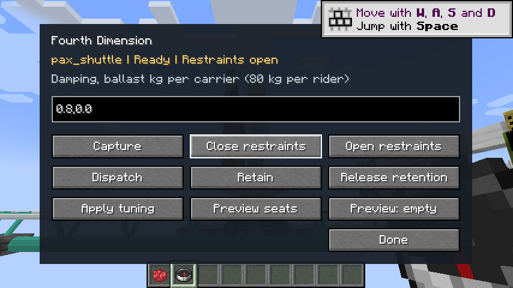

# Dev.14 caught boarding shuttle lifecycle checkpoint

This advances **FD902** toward 0.9.0. The current release stage remains completing
0.4. This checkpoint covers normal recovery of the four inherited PAX faults,
stationary boarding with an existing physical carriage, native holding and an
unoccupied packaged cold reopen. It does not close the full lifecycle gate.

## Normal operator recovery and the reproduced defect

A separate copy of the closed dev.13 comparison world retained its four older PAX
faults and the four newer clean PAX cars. No SavedData, player, winch or native body
NBT was edited. The existing powered winch at (94,85,-27) was inspected through
vanilla queries. Normal empty-hand sneak-use invoked its recovery action. The
controller entered CAPTURING, physically caught the train with carriage
`f80a03b5-c8bc-468c-8535-5554fa4048d7`, then returned to BOARDING. The normal rotation
tool reported Ready; its Open restraints action opened the entire four-car consist.
The held sneak-use also produced a normal rejected repeat binding attempt after
boarding; no rebinding or second recovery was accepted.

The closed save has zero vehicle faults, all four recovered restraints open, and
unchanged chassis/carrier identities and all 46 rail records. Recovery and opening
incremented each recovered vehicle revision from zero to two. The winch counter
is one, but maximum outbound distance is zero: **this is a recovery/capture counter,
not evidence of a full ride cycle in this checkpoint**.

The unchanged dev.13 JAR then reopened that saved boarding state at the same nearby
platform. At native tick 59850 the winch was available before the lead and carriage
were loaded, and changed BOARDING to FAULT / lead unavailable. One tick later all
four cars and the same carriage were available, but the fault and closed restraints
remained. The control was normally saved and exited; its failed state is retained.

## Production change and native regression

BOARDING never advances a carriage coordinate. While native bodies are restoring
or held/unloaded, it now preserves operating state. When both existing bodies are
available it rebuilds the stationary native guide/catch at the carriage's current
pose, without allocating a replacement, resolving the distant route or moving the
train. Actual winch block removal is still handled first. Dispatch, resume and
recovery require every needed body, matching unchanged support, valid route and
operating conditions; an assigned but unavailable carriage rejects before phase
advancement. There is no timeout, forced loading or automatic fault clearing.

Permanent native removal is handled separately through Sable's REMOVED observer.
Removing an assigned chassis, carrier or carriage faults the winch and retains the
remaining cars. UNLOADED does not invoke that path. A permanently destroyed carriage
is not silently replaced; reconstruction of destroyed equipment is outside this
checkpoint.

The new native regression uses normal fail/recover and restraint operations to
produce a physical boarding catch, serializes/reloads the real winch, then puts the
actual train/carriage dependency chain into Sable holding. The unchanged controller
fails with both bodies retained in holding and all four restraints closed. The
fixed controller preserves phase, faults, restraints, revisions, coordinate, cycle
counter and carriage ID. Normal restoration returns four ready cars, eight carriers
and the four-car consist. Missing bodies and an actually deleted remote route anchor
reject dispatch. Actual REMOVED carriage destruction faults immediately and rejects
recovery without replacement allocation. Both standalone and combined runs pass all
**30 required native tests**; the Java 21 build passes all **25 unit tests**.

## Packaged fixed comparison and default cold reopen

The fixed JAR uses a separate copy of the same clean, recovered boarding save.
Nearby reopen reports BOARDING and Ready / restraints open through normal queries
and the rotation tool. A normal stone viewing platform and teleport to
(-121.5,90,-26.5) then reproduce an available winch with no loaded cars or carriage
at tick 60719. The winch remains BOARDING with an empty fault. Normal Save and Quit
and game exit preserve every non-angular vehicle field and every rail record.

A fresh packaged JVM reopens at that boundary with all four validation flags false.
A vanilla query still reports BOARDING, the original carriage, unchanged coordinate
and an empty fault. Returning to the train restores the visible physical assembly
and Ready / restraints open editor. RootVehicle and NoGravity queries have no
matching elements. Final normal save/quit and game exit complete successfully.
The final save retains 13 chassis, 30 carriers, 46 rails, empty rider assignments,
zero vehicle faults, open restraints and the same winch/carriage state.

## Evidence and remaining gates

`caught-*-events.txt` contains selected native logs and terminal build results;
`caught-*-save.json` contains read-only SavedData snapshots. Winch snapshots are
read from the closed vanilla region file using the saved inspection script;
`caught-cold-validation-flags.txt` records the actual run arguments. Screenshots
show normal recovery, the failed control and the fixed default-flags editor.
`python3 scripts/verify-caught-shuttle-checkpoint.py` checks these recorded artifacts;
it does not replay the client or certify other lifecycle cases.

The fixed JAR SHA-256 is
`00db91b038658488676962ee85caf02692d2b8963a5ff0e9c306031459b7bcdc`.
The unchanged dev.13 control SHA-256 is
`68046fab96ebca81ce1e639337ea8fd189b52ef37ad413d881849f56175280ac`.
Both native profiles use the same fixed artifact, without bundled optional JARs.
Profiles use the already pinned Track Styles 1.2.0 and Engineered 1.1.1.

Occupied caught-boarding cold reopen, the complete multiplayer/disconnect/support
loss matrix, migration and performance acceptance remain open. Full 0.4 acceptance
also remains open. The original dev.8 bitmap-glyph crash is unresolved; preserving
this shuttle state does not establish a font fix or complete render-mode coverage.
