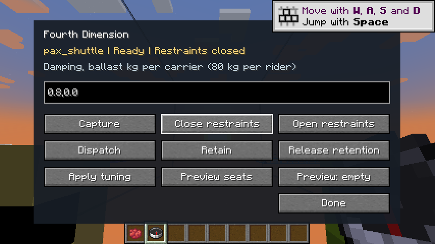
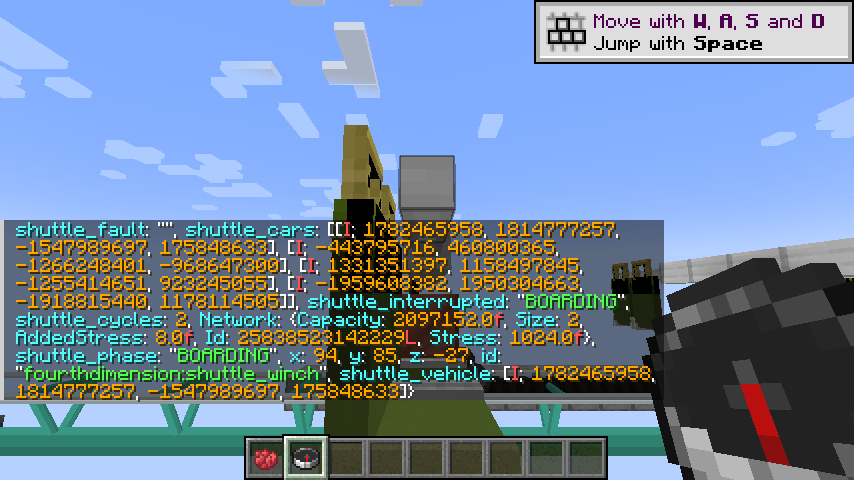

# Occupied caught-boarding acceptance on dev.14

This advances **FD902** toward 0.9.0 using the unchanged packaged
`0.9.0-dev.14` artifact. It covers one real single-player rider, two successive
fresh-JVM boarding restores, a complete post-reopen ride and normal unloading.
It does not close the complete multiplayer/lifecycle gate or earlier 0.4 gates.

## Fixture and ordinary interactions

The closed, fault-free final dev.14 world was copied into an isolated game
directory. No player, winch, SavedData or native body NBT was edited. The combined
pack uses the already pinned Track Styles 1.2.0 and Engineered 1.1.1. All three
packaged client JVMs run with pose, Ponder, scheduler and shuttle validation flags
false. The artifact SHA-256 remains
`00db91b038658488676962ee85caf02692d2b8963a5ff0e9c306031459b7bcdc`.

The player boards through the normal empty-hand PAX seat interaction. The mounted
rotation tool recognizes the car; its Close restraints action closes the entire
four-car consist. A normal shift attempt is rejected, leaving the same native
seat mount. The winch remains BOARDING, has its existing physical carriage, and
keeps the station coordinate `62.67979295672922`. Save and Quit followed by Quit
Game completes normally.

The closed save contains exactly one rider assignment, on the original carrier
with UUID int array `[-1438414630,-672774460,-1770187835,2031710251]`, seat offset
encoded as `274877911039` (local `(1,-1,0)`). The player's RootVehicle references
one native `create:seat`. All four target restraints are closed and every vehicle
fault is empty.

## Two occupied cold restores

A new JVM reopens the occupied save. Sable logs that the tracking point belongs
to an unloaded sub-level and attempts normal loading. The player restores to the
same carrier and local seat offset; the mounted editor reports Ready / restraints
closed. Vanilla RootVehicle inspection identifies the restored native seat. An
`execute as @e[type=create:seat]` UUID query returns exactly one seat in the loaded
scene, and the player's NoGravity query has no matching element.

The transient Create seat entity UUID is recreated; chassis/carrier identity and
rider assignment are preserved. The old seat entity is not observed alongside
the restored one. Normal save/quit and game exit produce a second closed snapshot.
All non-angular vehicle fields, rider assignments, carrier settings and rail
records match the first occupied snapshot. Every persisted shuttle field,
including carriage UUID/coordinate/counter, matches exactly.

A third fresh JVM reopens this restored occupied snapshot. It again restores one
native seat, Ready / restraints closed and the same rider/carrier/slot. This is
repeated single-player boarding restoration, not a two-client or late-join claim.

## Full ride after reopening and normal unloading

Normal mounted-editor Dispatch starts the physical lift. Read-only vanilla phase
queries record **LIFTING → OUTBOUND → RETURNING → CAPTURING → BOARDING**. The query
sampler waits for actual native acknowledgements and never changes simulation
state or restarts the client. Screenshots cover each observed phase. The rider
remains mounted in the same recreated seat before and after this ride; a second
all-seat UUID query still returns exactly one seat.

Final native winch data has an empty fault, the original carriage, the original
station coordinate, counter **2**, and maximum outbound coordinate
**104.92097213095396**. Counter one came from the preceding dev.14 recovery/capture;
this test adds **one complete ride cycle**. Ready / restraints closed is confirmed
through the mounted editor before opening restraints.

Normal Open restraints then Shift unloads onto the existing winch/platform surface
at `(94.5,86,-26.5)`. RootVehicle and NoGravity queries have no matching elements.
A direct query for any remaining native seat returns `No entity was found`.
Normal save/quit and game exit complete successfully. The final save contains no
rider assignments or occupants, no vehicle faults, all restraints open and all
cars ready/captured. The player is on the ground without a mount or gravity override.
All 13 chassis, 30 carriers and 46 rail records retain their identities and bindings.

## Recorded evidence and remaining work

`occupied-*-events.txt` contains selected native logs, queries and terminal build
results. `occupied-*-foundation.json`, player snapshots and winch snapshots are
read-only inspections of closed native saves. `occupied-ride-phases.json` records
the actual phase acknowledgements; the sampler source is retained as text.
First/cold VM flag records and the isolated game-directory configuration accompany
the screenshots. Run `python3 scripts/verify-occupied-shuttle-checkpoint.py` to
check these observations; it does not replay clients or certify the full gate.

No production source or artifact change was needed. The preceding code checkpoint
passes 25 unit tests and 30 native tests in all four CI profiles; its exact-head
push/PR results are retained as `caught-ci-{push,pr}.json`.

The complete two-client/late-join/disconnect matrix, occupied route/support loss and
all-family lifecycle coverage remain FD902 work. This fixture does not certify
survival construction, towing, migration, rendering modes or performance. The
original bitmap-glyph crash remains unresolved. All three owned clients and the
isolated display were stopped after their normal exits.
