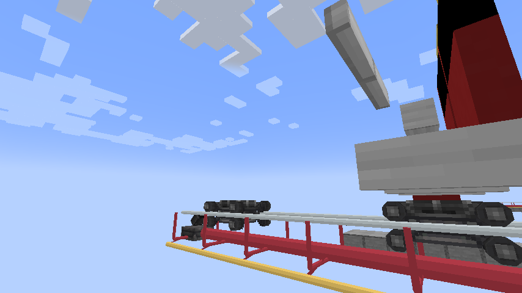

# FD904 packaged rendered recovery capture

This is a scoped FD904 visual checkpoint: it records pixels from a live,
packaged client in the existing `FD16Recovery` single-player world. It is not a
shader, framerate, clearance, or interactive F3+T acceptance result.



## Method

The packaged 0.9.0-dev.27 JAR ran with Track Styles 1.2.0 and Coasters:
Engineered 1.1.1 under a 1280x720 Xvfb display. Minecraft quick-played the
committed `FD16Recovery` world. The cursor was captured by the live client,
the HUD was toggled off, and the camera was turned to show the recovery vehicle,
native chassis, original red rail/support geometry, and the adjacent rail run.
The framebuffer was captured with `scrot`, then cropped to Minecraft's 854x480
content viewport without changing its pixels.

```sh
Xvfb :99 -screen 0 1280x720x24 -nolisten tcp
DISPLAY=:99 JAVA_HOME=/usr/lib/jvm/java-21-openjdk \
  ./gradlew runClient --no-daemon -PfdPackaged \
  -PfdIntegrations=styles,engineered -PfdWorld=FD16Recovery
DISPLAY=:99 scrot capture.png
```

## Result

The committed capture is 854x480 PNG, SHA-256
`d55ad29d764300da73244040b973d2760f324c28bfe4e429179329103eadc8e9`.
It visibly contains the selected recovery vehicle's native components, matching
original red rails and supports, and nearby native cart bodies. No error screen,
missing-texture marker, or empty renderer is present in this captured frame.

## Limits

The capture used llvmpipe and a recovery-world camera angle. It cannot establish
continuous clearance, player-rider rendering, every family/model, all optional
decorations, a shader backend, or target-hardware FPS. Those remain FD401,
FD402 and FD904 acceptance work.
