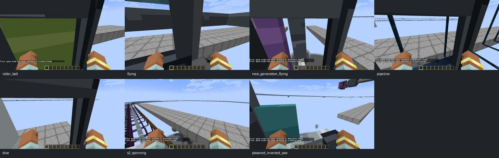

# Remaining occupied park views

All seven remaining mounted segments finished on immutable runtime14 with fresh
combined16 collectors. Each has actual movement, all90 occupied seats retained,
no reported group fault, normal ready return, Open and actual Shift dismount.
Helper boarding remains disclosed setup, not normal player-construction/input
acceptance. Together with Arrow in the fixed window and the nine accepted15/15b
segments, every17-style view is covered. [Cleanup](cleanup-combined16.json) verifies all three units inactive/PID0 after
normal fixture unload, world save and checkpoint `world-drained16`.

|Style|Occupied game ticks|Sampled center path (blocks)|Frames|Frame p95 ms|Tick p95 ms|
|---|---:|---:|---:|---:|---:|
|roller_ball|7720|732.61|87559|7.386|52.027|
|flying|2849|802.73|14937|14.567|47.428|
|new_generation_flying|9139|812.00|98674|9.789|48.735|
|pipeline|2348|802.59|8230|20.837|54.107|
|dive|4377|1028.67|20694|15.430|51.625|
|s2_spinning|1738|639.43|11371|14.920|53.809|
|powered_inverted_yaw|3156|454.65|20806|13.274|53.618|

These per-style intervals have different durations/view content and are supplemental
to the fixed300-second comparison and accepted1800-second sustained workload.
They do not create a universal per-style FPS/tick target or replace either window.
[First four summaries](occupied16-summary.json) and [last three summaries](occupied16b-summary.json)
include every percentile/resource distribution and exact bounds. The
[raw manifest](combined16-raw-manifest.json) preserves lossless JVM footers with
zero dropped events, closed resource samplers and compressed original records.
[Execution identity](execution-combined16.json) retains the actual Java21 JAR,
private display323, ports25664/25665 and process limits.

The initial Dive interval did not move and is excluded from accepted ride statistics.
Its first helper dispatch transferred authority from the drop controller back to
the station and returned before closing restraints or dispatching. The paused
fixture suppressed the automatic subsequent dispatch. Source and live state
confirmed station controller(545,110,116), owner and cycle7/open/ready; the helper
was stopped without replacing the world or passenger. The
[bounded helper correction](combined16b-tools.json) verifies that transfer-only
readback before one actual dispatch and fails early on a still-docked result.
Continuation from the same mounted seat closed restraints, incremented cycle8,
and moved40.50blocks in106ticks with all6 Dive riders. Its actual route and
normal unload then passed; S2 and Powered Inverted Yaw followed in that same client.
This corrects benchmark sequencing, with no production mechanics change.

The reviewer inspected the seven labeled movement captures; these are performance
view references and reuse existing family-specific art/body/camera acceptance.
The separate Pipeline JFR precedes these segments and is diagnostic only; see
[renderer repair](renderer-repair.md). It is not part of a fixed acceptance window.
