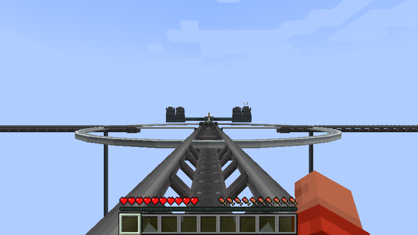
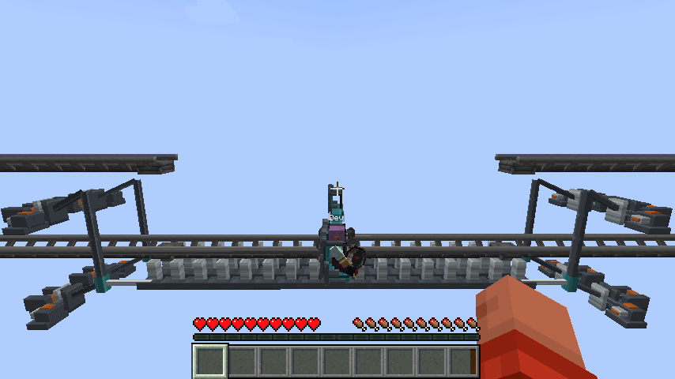
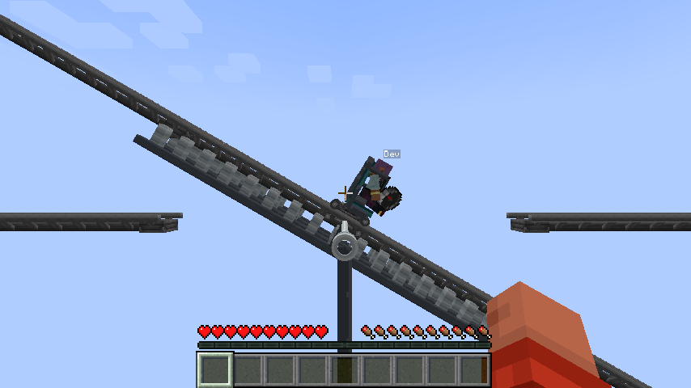
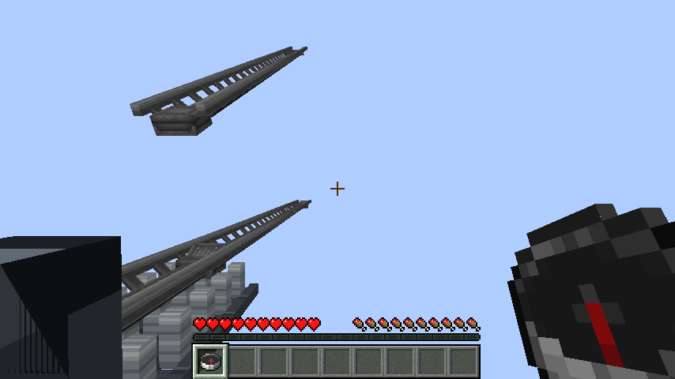
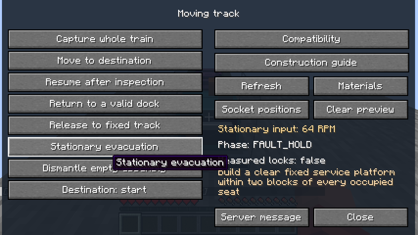
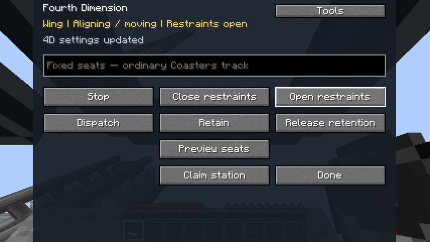
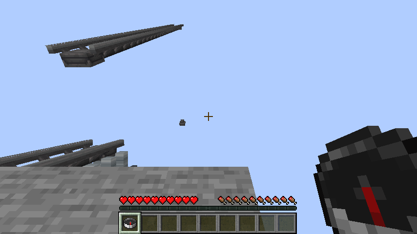

# Occupied yaw, drop, pitch and stationary evacuation

2026-11-26, owner `/root/fd15_occupied_axes`, primary `main`, base HEAD
`f85f4a277c7c7542a4f07a158f18f580beb41187`; authorized 1.5 changes uncommitted.
The three distinct occupied base-axis cases pass. Existing translation and native
mechanism cases are reused. This run also proves stationary evacuation from an
unreleased endpoint-loss fault and from a released service train.

## Frozen run

Artifact SHA-256 `9c5d155d8ac7dafff0429af26b8d0bf1e4c0520b72aceab918d02ed9b863483c`.
Java 21.0.13.1, Gradle 9.2.1; `package-axes-20261126.log` reports successful package.
The immutable tested JAR and raw logs are under
`/mnt/NVME4/fourthdimension-runs/fd15-content-20261122/evidence/axes-20261126/`.
Runtime root is its parent twice, and the retained fresh world is
`server/world-axes-20261126`. Previous content world remains intact.

Two actual connected clients: Dev rider on private Xvfb `:353`, Observer operator
on `:354`; server/RCON loopback 25831/25832. Client heaps 1536M, each separate
6GiB Minecraft-only service; server 2048M heap / 4GiB service. Measured peaks were
2,715,828,224 / 2,690,658,304 / 1,511,817,216 bytes respectively. Headroom before
clients was 42GiB available. All runtime/build/evidence storage is persistent XFS
on NVME4. Gradle ran outside game services. Default right-use/left-attack and raw
mouse input remained unchanged. Windows were 854×480, GUI scale 2, 40 FPS cap.

Disclosed setup commands supplied isolated platforms, native endpoint anchors,
24m fixed approaches, actual Create motor 64 RPM, ingredient bills, native Wing
cars and initial player positions/aim. No command installed riders, restrained,
captured, moved, released, evacuated or dismounted them. Normal survival GUI
Preview/Validate/Build, empty-hand boarding, Rotation Tool restraint controls,
operator destination selection/Capture/Move were observed independently for each
axis. Temporary boarding footholds were removed before motion. Private XTest
camera movement changed rider yaw from 0 to 3.15 degrees; normal right-use mounted
the actual seat. Input/readback JSONL and console setup log are retained.

## Distinct axis results

| Case | Original vehicle | Native measured result | Raw state |
| --- | --- | --- | --- |
| Yaw | `b97c570b-eca0-4ce9-9ac0-d1e2e18629ce` | 89.99999517° yaw, measured locks, RECONNECTED | `yaw-docked.txt` |
| Drop | `bcdf3168-8082-4a49-aff3-eaf7b85f05ec` | Bed origin Y 128.499999999999 → 124.500007629395; measured locks, RECONNECTED | `drop-captured.txt`, `drop-docked.txt` |
| Pitch | `6a0a0a8b-6ebd-4aa0-9f42-7ed95e6cc57b` | 29.99999517° pitch, measured locks, RECONNECTED | `pitch-docked.txt` |

All three preserve Dev UUID `380df991-f603-344c-a090-369bad2a924a`, outer seat
local `(4,1,0)`, original vehicle and seat entity, and closed restraints throughout
motion. Their original seat entities are respectively
`09390166-a364-4971-a532-78b4a06eadbe`,
`f4ef5b29-2c9a-4334-82ca-cc0c726605a5`, and
`ae7efb71-c059-4174-bf48-ab0f40f52439`. Both clients' diagnostics report the same
occupant identity; Observer views show that actual rider attached to the physical
bed through distinct motion. Rider camera quaternion during pitch changes from
approximately `(0,-1,-0.005226,0)` before motion to
`(0,-0.9646,-0.2638,0)` at destination. This is camera motion evidence; the diagnostic
`snapshotAngle=0/nativeAngle=0` is the Wing's separate seat-rotation field and is
not incorrectly credited as the moving bed's pitch.

## No-dock evacuation

After the accepted pitch reached RECONNECTED, disclosed removal of destination
native endpoint `(211,124,10)` caused FAULT_HOLD with locks false and retained
original bodies/rider. No release or teleport-to-dock was used. The controller's
normal Stationary evacuation action refused until every occupied seat had a clear
fixed platform. Screenshot `evacuation-refused.png` shows that specific refusal.

A disclosed 4×4 stone service platform at X206–209, Y127, Z2–5 changed the failed
precondition. Normal operator Stationary evacuation then succeeded, normal rider
Open restraints succeeded, and voluntary Shift exited to `(206.5,128,4.5)`.
`pitch-evacuated.txt` retains the endpoint fault and original vehicle with empty
riderSeats and open restraints. The body stayed physically held. The subsequent
ordinary camera turn changed yaw to 3.1499524°; no forced passenger teleport or
vehicle replacement occurred. The endpoint remains absent in the preserved world
for diagnosis/recovery continuation; the unoccupied assembly remains safely held.

Additional compatible evidence: yaw normal Release reached RELEASING. Open
restraints on the moving bed were correctly refused; these beds are not boarding
stations. Dispatch correctly refused the fixture's missing real powered Chain
span. Normal Stop secured the released service car, evacuation refused without a
platform, then accepted a fixed platform and normal Open/Shift exit. Drop likewise
used normal Stop to enter unreleased FAULT_HOLD and validated platform evacuation.
These are distinct service/retained cases, not proof of normal powered departure.
No generic fixed-track departure claim is made by these unpowered approaches.

## Input corrections and cleanup

The first yaw Capture correctly refused until the configured end destination was
selected. Destination approach geometry obstructed the initial controller line of
sight; a calculated side position was verified by F3 target before use. A missed
release input was not credited; the panel was reopened with the debug overlay
cleared, then actual RELEASING acknowledgment was recorded. A stale rider menu
request and a stale evacuation epoch request were refused, refreshed, and evaluated
against current state. No unsuccessful request is represented as a pass.

Both players used Disconnect, then Quit Game. Server list confirmed zero players;
`save-all flush` completed, `stop` saved all dimensions and terminated RCON cleanly.
Only after client/server exit were both owned Xvfb services stopped.
`cleanup.txt` confirms all five exact owned services inactive, MainPID 0. Worlds,
raw logs, full input readbacks/screenshots and frozen artifact are preserved. No
source changes, commits, tags or publication were performed for this run.
