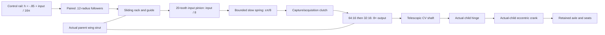

# Arrow production mechanism contract

2026-11-15; rail transmission verified in the [bounded lead evidence](README.md).
The occupied lifecycle and final baked-axle crank/stay fit passed in Art's current
build. VP03 is accepted cumulatively; whole-package acceptance remains assigned.

The preserved control mapping is `height=-.85+angle/(16*pi)`: one actual axle
turn displaces the follower .125 block. The input rack pinion has radius
`1/(2*pi)` and 20 teeth at .05-block pitch. Its angle is unwrapped axle input/8.
A 64:16 stage and 32:16 stage multiply by 8; two external meshes preserve sign.
The gear tooth relief is .007 block (intentional .014 combined tooth-depth
clearance/intermesh envelope). This is original simplified gear geometry, not an
involute engineering replica. Running rails and saved angle programs are unchanged.

A single narrow top/bottom follower pair contacts each control rail at the chassis
center station used by the server. Each roller has .12 radius and sits .21 block
above/below the .09-radius rail center. The rail frame carries an articulated
rack guide; its supports and telescopic CV shaft connect to the actual chassis
and actual interpolated child axle. The rack remains unwrapped across full turns.
The output phase comes from the parent/child render quaternions, using the retained
unwrapped carrier angle as its winding reference. No target quaternion replaces
the actual axle or rider pose.

The slow-stage torsion spring permits +/-pi/8 radians, equivalent to +/-pi axle
error or .0625 block of input stroke. Both radial ends of the exposed coil attach
to their shaft hubs. The clutch has an explicit axial separation in capture or
acquisition. The native rotary servo is represented by a neutral-return actuator
at the output: capture does not claim the non-neutral rack still rigidly drives
the neutral seat. Input spring unloads when disengaged; the actual output continues
through the gearbox/shaft. Late client data fails open beyond the spring bound.

`control_coupled` is saved/synchronized per carrier; old saves default disengaged.
On release or reload, the existing servo acquires the actual target with the clutch
open until error is <=pi-.15; no pose snap or wrapped-modulo shortcut is used.
Once coupled, an error greater than pi releases the clutch and invokes the normal
linked stop/capture authority, with an explicit overtravel fault. This is the one
new mechanical response to an untrackable input discontinuity. It is not a reason
to classify a supported normal program as unsafe. Ordinary valid profiles must
remain inside the modeled envelope in the affected checks.

## Native measurement and targeted check

Persistent run root `/mnt/NVME4/fourthdimension-runs/fd917-lead-20261115`.
Baseline `arrow-baseline-01.log`: 1312 samples, maximum ordinary lag
.7160527024645056 rad, capture mismatch 1.9018147502814182 rad, actual winding
-.0026908669 through 6.2826067885 rad. Server saved/exited normally.

`arrow-coupling-02.log`: one targeted Java21 GameTest passed. Same ordinary peak,
1624 coupled carrier samples, nonzero capture disengagement and persistence
roundtrip passed; an intentionally injected +8-radian discontinuity after engagement
released/stopped/captured with the named fault. Server saved/exited normally.
The subsequent live evidence in README.md establishes full-stroke forward/reverse
contact, nonzero capture, reload and shared renderer cost. Art supplies the occupied
shared-contract view; unchanged linked geometry retains its existing native evidence.

## Retained axle interface

The child hinge is local (.5,.5,.5), while the retained baked axle center is
(.5,.5,-5.5/16). An actual-child-pose crank runs from the hinge to
(.5-side*.36,.5,.5), then to (.5-side*.36,.5,-5.5/16). It joins the eccentric
shaft without moving native pivots, seats or physics. The .07-block radial member
lies at the inboard side of the bucket. Source compilation and Art's neutral/nonzero occupied fit view passed. This narrowly affected view does not reopen
rail contact, full stroke or the completed occupied operator cycle.

The guide/gearbox also has two explicit articulated stays ending in the actual
parent wing-strut web at local `(.5+side*x,2.5,.5)`, for x=1.65 and 2.02.
Using the parent render pose prevents a rail-frame approximation from floating
beside the chassis on curves. These stays and the crank share the accepted final fit
view; `compile-chassis-interface.log` passed after this final support addition.

The diagram shows the simplified presentation contract; the native rotary servo
still supplies motion authority. When the clutch opens, the output/servo remains
connected to the child, while the input spring unloads with the rail follower.
