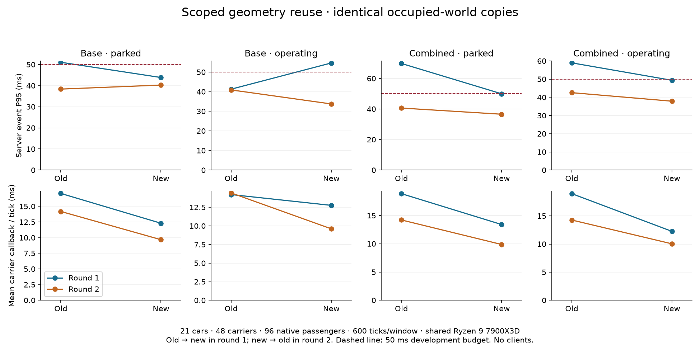

# FD904 reuse a vehicle's geometry within one physics update

The [occupied-scene baseline](../server-benchmark/README.md) identified repeated
native chassis-bearing scans and track projections in the carrier callback.
For each normally supported Arrow car, boundary checking scanned the chassis and
projected its position, then rotation control scanned it twice more and projected
it again before physics advanced.

`VehicleTrackSample` now lazily resolves the chassis center, matching graph edge,
and closest hit once for that vehicle update. `BoundaryGuard` and controlled
rotation share those values. The object is local to `CarrierRuntime.tick` and
never survives the update. Braking between the reads changes velocity, not pose.
There is no cross-tick, saved, or network cache and no cache invalidation policy
to synchronize. Standalone boundary calls create their own fresh sample.

Functional provider checks, linked-consist validation, missing-gear/track faults,
shuttle ownership and boundary braking still run in their original order. The
change does not bypass checks for stationary or held cars. The artifact comparison
allows exactly two changed classes (`CarrierRuntime`, `BoundaryGuard`) and one
added class (`VehicleTrackSample`), with no changed resources or schema.

## Native verification

The existing 35 registered GameTests run independently in base, Engineered,
Track Styles, Additions, Magnetized, Immersion, and combined profiles. Optional
absence is recorded as an explicit skip, not compatibility evidence. The audit
checks actual boundary observations in both directions, connected-family and
appearance decisions, linked-provider loss, controlled turns and differing axle
angles, delayed passenger restoration, and all four occupied PAX phase reloads.
Engineered and combined runs enable their native FE reload checks. The build also
runs the 19 unit tests.

## Paired performance method

Both immutable JARs run on copies of the exact same occupied seed used by the
baseline: two seven-car Arrow trains, three eight-seat Free Spin cars, and a
four-car PAX shuttle, totaling 21 cars, 48 carriers and 96 native pig passengers.
Each process warms up for 600 ordinary ticks, then records 600 unfrozen parked
ticks and 600 operating ticks. Dispatch happens while unfrozen so Create's
kinetic speed check remains valid. Every process starts from a fresh seed copy;
there is no cumulative motion across repetitions.

Two rounds compare base and combined packs. The first round runs old then new;
the second runs new then old. This balances order without claiming to eliminate
shared-host variation. The 16 windows contain 9,600 measured ticks; the timing
scope is the same server Pre-to-Post bracket and process-wide carrier callback
counter as the baseline. The Arrow rotation profile is flat and no optional
motor, brake, custom appearance, client or shader is active. The parked window
also warms the operating window, identically for both artifacts.

This is the same Ryzen 9 7900X3D shared host and pinned mod stack as the baseline,
with a 2 GiB game heap and 158 forced scene chunks. Host load is recorded per case.
No profile recordings or concurrent regression builds run during these timing
windows. Absolute timings from the earlier session are not used as paired controls.
The 50 ms P95 server-development budget remains a necessary, incomplete target;
client/rendering, moving inversion, active optional equipment and full release
capacity still require separate evidence.

## Results and decision

All 16 accepted windows pass the identity, restraint, coupling, loaded-body and
saved-data checks. All 96 original passengers remain attached to their original
native seats and carriers. Every operating window observes lifting, outbound,
returning and capturing. These short windows end during capture; they do not add
full-cycle unloading evidence.

| Pack | Round | Window | Mean carrier callback, old → new (ms/tick) | Reduction | Server-event P95, old → new (ms) |
| --- | --- | --- | --- | --- | --- |
| Base | 1 | parked | 17.06 → 12.30 | 27.9% | 51.05 → 43.83 |
| Base | 1 | operating | 14.21 → 12.76 | 10.2% | 41.26 → 54.63 |
| Base | 2 | parked | 14.18 → 9.67 | 31.8% | 38.35 → 40.26 |
| Base | 2 | operating | 14.43 → 9.61 | 33.5% | 40.89 → 33.74 |
| Combined | 1 | parked | 18.87 → 13.40 | 29.0% | 69.79 → 49.95 |
| Combined | 1 | operating | 18.96 → 12.26 | 35.4% | 58.96 → 49.37 |
| Combined | 2 | parked | 14.21 → 9.87 | 30.5% | 40.61 → 36.57 |
| Combined | 2 | operating | 14.27 → 10.04 | 29.7% | 42.57 → 37.88 |

The mean carrier callback is lower in all eight comparisons, by 10.2–35.4%.
Mean server-event time improves in seven comparisons; the first base operating
window instead rises from 33.95 to 39.82 ms. Two server-event P95 comparisons
worsen. The new artifact meets the 50 ms P95 development target in seven of eight
windows, with a 54.63 ms exception. The shared host's recorded one-minute load
ranges from 19.38 to 54.99 across the retained trace. The code removes redundant work,
but these observations do not isolate its causal speedup from host, GC and runtime
variation, and do not establish a pack-wide performance guarantee.

Retain the narrow optimization: all seven native regression profiles pass with
19 unit tests, and both run orders show less callback time. Keep FD904 open for
consistent server targets and the unmeasured client/render/equipment scenarios.
Exact per-window means, P95/P99, maxima and over-budget counts are retained in
[verification.json](verification.json); [manifest.json](manifest.json) identifies
both immutable JARs and every retained source/evidence hash.



All 23 tracked process handles, including the interrupted attempt and coordinators,
are terminal. The private Minecraft/RCON ports are closed and the original server
settings match their pre-run SHA-256. Full failed and accepted world copies remain
in the ignored workspace evidence directory.

## Interrupted observation and recovery

The first `base-0-new` attempt exposed a reader race: the Python harness tried to
parse a partial record while the server was still appending a large JSON sample
(`JSONDecodeError` at character 57,258). The server then shut down normally and
logged `BUILD SUCCESSFUL`; its process return code was not retained by that exceptional path. The failed
attempt's logs, parked sample, status and executed driver remain under
`failed-attempt/`. Neither of its timing windows contributes to the paired results.

The corrected reader accepts only newline-terminated records. The audit exercises
it against a complete native record, a truncated prefix (deferred), and a complete
malformed record (rejected). A fresh seed copy named `FDProjectionReuseBase0NewRetry`
repeats the affected case. The completed old control remains in the sequence;
all other cases use the original order. This interruption adds a longer gap to
that first pair and is another reason not to infer an isolated causal speedup
from one pair. No runtime change or native-suite rerun was needed for this harness
repair.

## Reproduction and audit

The driver files retain the exact Gradle commands, seeds, process handles, samples,
world data and property restoration checks. `benchmark-executed.py.gz` retains
the exact executed coordinator; `benchmark.py` only removes trailing whitespace.
The benchmark waits on the live native
regression coordinator and only starts if all seven profiles pass. Full copied
worlds remain under the ignored `build/projection-reuse/worlds` directory.

Run from the checkout root:

```sh
python3 scripts/verify-projection-reuse.py docs/evidence/integrations/2026-10-01/projection-reuse
```

The verifier checks raw logs against every sample, all 21 chassis/48 carriers/96
rider and seat identities, couplings, movement, phase counts and saved schema-5
state. It reports both per-window and paired timing results; it never silently
drops slow windows. Native logs retain upstream warnings. This checkpoint does
not by itself close FD904 or the wider integration certification goal.
